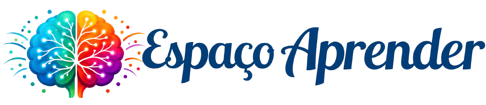
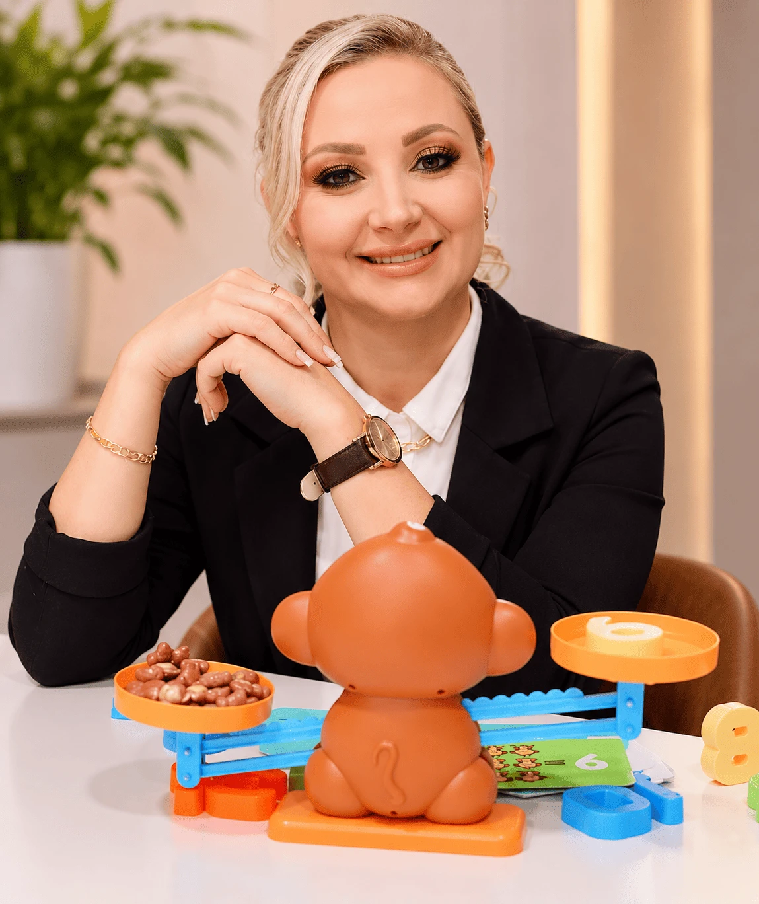
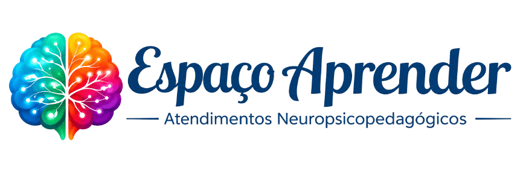

<!doctype html>
<html lang="pt-BR">
<head>
<meta charset="utf-8">
<meta name="viewport" content="width=device-width, initial-scale=1">
<title>Espaço Aprender | Neuropsicopedagoga Franciele Levandovski – Seara/SC</title>
<meta name="description" content="Espaço Aprender – Atendimentos neuropsicopedagógicos com Franciele Levandovski, Mestre em Educação e Neuropsicopedagoga Clínica, em Seara/SC.">
<meta property="og:title" content="Espaço Aprender – Franciele Levandovski">
<meta property="og:description" content="Atendimentos neuropsicopedagógicos em Seara/SC. Um espaço acolhedor para aprender do seu jeito.">
<meta property="og:image" content="img/logo-horizontal.png">
<link rel="icon" type="image/png" sizes="32x32" href="img/favicon-32.png">
<link rel="icon" type="image/png" sizes="48x48" href="img/favicon-48.png">
<link rel="icon" type="image/png" sizes="512x512" href="img/icone-512.png">
<link rel="apple-touch-icon" href="img/apple-touch-icon.png">

<link rel="preconnect" href="https://fonts.googleapis.com">
<link rel="preconnect" href="https://fonts.gstatic.com" crossorigin>
<link href="https://fonts.googleapis.com/css2?family=Baloo+2:wght@500;600;700;800&family=Caveat:wght@600;700&family=Nunito:wght@400;600;700;800&display=swap" rel="stylesheet">

</head>
<body>

<!-- ícones (desenhados uma vez, usados com <use>) -->
<svg width="0" height="0" style="position:absolute" aria-hidden="true">
  <symbol id="i-pin" viewBox="0 0 24 24"><path d="M12 22s7-6.2 7-12a7 7 0 0 0-14 0c0 5.8 7 12 7 12Z"/><circle cx="12" cy="10" r="2.5"/></symbol>
  <symbol id="i-search" viewBox="0 0 24 24"><circle cx="11" cy="11" r="7"/><path d="m20 20-3.5-3.5"/></symbol>
  <symbol id="i-puzzle" viewBox="0 0 24 24"><path d="M9 4h3a2 2 0 1 1 4 0h3v5a2 2 0 1 1 0 4v6h-5a2 2 0 1 0-4 0H4v-6a2 2 0 1 0 0-4V4h5Z"/></symbol>
  <symbol id="i-book" viewBox="0 0 24 24"><path d="M4 5.5A2.5 2.5 0 0 1 6.5 3H20v15H6.5A2.5 2.5 0 0 0 4 20.5v-15Z"/><path d="M4 20.5A2.5 2.5 0 0 0 6.5 23H20v-5"/></symbol>
  <symbol id="i-family" viewBox="0 0 24 24"><circle cx="8" cy="7" r="3"/><circle cx="17" cy="9" r="2.2"/><path d="M2.5 20a5.5 5.5 0 0 1 11 0M14 20a3.5 3.5 0 0 1 7 0"/></symbol>
  <symbol id="i-school" viewBox="0 0 24 24"><path d="m3 9 9-5 9 5-9 5-9-5Z"/><path d="M7 11.5V16c0 1.5 2.2 3 5 3s5-1.5 5-3v-4.5"/></symbol>
  <symbol id="i-mic" viewBox="0 0 24 24"><rect x="9" y="3" width="6" height="11" rx="3"/><path d="M5 11a7 7 0 0 0 14 0M12 18v3"/></symbol>
  <symbol id="i-clock" viewBox="0 0 24 24"><circle cx="12" cy="12" r="9"/><path d="M12 7v5l3 2"/></symbol>
  <symbol id="i-access" viewBox="0 0 24 24"><circle cx="12" cy="4.5" r="1.8"/><path d="M8 9h8M12 9v5l3.5 6M12 14l-3.5 6"/></symbol>
  <symbol id="i-car" viewBox="0 0 24 24"><path d="M5 16V11l2-5h10l2 5v5M3 16h18v3H3zM7 19v2M17 19v2"/><path d="M5 11h14"/></symbol>
  <symbol id="i-route" viewBox="0 0 24 24"><path d="M3 11 21 3l-8 18-2-8-8-2Z"/></symbol>
  <symbol id="i-ig" viewBox="0 0 24 24"><rect x="3" y="3" width="18" height="18" rx="5"/><circle cx="12" cy="12" r="4"/><circle cx="17.5" cy="6.5" r=".6"/></symbol>
  <symbol id="i-wa" viewBox="0 0 24 24"><path stroke="none" fill="currentColor" d="M12 2a10 10 0 0 0-8.6 15.1L2 22l5-1.3A10 10 0 1 0 12 2Zm0 18.2a8.2 8.2 0 0 1-4.2-1.2l-.3-.2-3 .8.8-2.9-.2-.3A8.2 8.2 0 1 1 12 20.2Zm4.5-6.1c-.2-.1-1.5-.7-1.7-.8-.2-.1-.4-.1-.6.1l-.8 1c-.1.2-.3.2-.5.1a6.7 6.7 0 0 1-3.3-2.9c-.2-.4.3-.4.8-1.3.1-.2 0-.3 0-.4l-.8-1.8c-.2-.5-.4-.4-.6-.4h-.5a1 1 0 0 0-.7.3 3 3 0 0 0-.9 2.2 5.2 5.2 0 0 0 1.1 2.8 11.9 11.9 0 0 0 4.6 4c1.7.7 2.4.8 3.2.7.5-.1 1.5-.6 1.8-1.2.2-.6.2-1.1.1-1.2l-.2-.2Z"/></symbol>
  <symbol id="squig" viewBox="0 0 90 14"><path d="M2 8c8-6 14-6 22 0s14 6 22 0 14-6 22 0 12 5 20 0" fill="none" stroke-width="4" stroke-linecap="round"/></symbol>
</svg>

<header id="topo">
  <nav class="wrap nav">
    
    <ul class="menu" id="menu">
      <li><a href="#sobre">Sobre</a></li>
      <li><a href="#como-ajudo">Como ajudo</a></li>
      <li><a href="#como-funciona">Como funciona</a></li>
      <li><a href="#onde">Horários e local</a></li>
    </ul>
    <a class="btn btn-wa wa-link" href="#" target="_blank" rel="noopener">
      <svg class="wa"><use href="#i-wa"/></svg> Agendar
    </a>
    <button class="burger" id="burger" aria-label="Abrir menu" aria-expanded="false" aria-controls="menu"></button>
  </nav>
</header>

<main>
  <!-- ===== HERO ===== -->
  <section class="hero" id="inicio">
    
    
    

      

        <svg class="i"><use href="#i-pin"/></svg> Seara · Santa Catarina
        <h1>Cada criança aprende do seu jeito<svg viewBox="0 0 200 16" preserveAspectRatio="none" aria-hidden="true"><path d="M3 10c40-7 90-8 130-5 22 2 44 3 64 0" fill="none" stroke="#ffc533" stroke-width="7" stroke-linecap="round"/></svg></h1>
        e aqui a gente respeita isso
        
No <strong>Espaço Aprender</strong>, a neuropsicopedagoga <strong>Franciele Levandovski</strong> acolhe crianças para entender como cada uma aprende — e transformar as dificuldades em novas descobertas.

        

          <a class="btn btn-wa wa-link" href="#" target="_blank" rel="noopener"><svg class="wa"><use href="#i-wa"/></svg> Conversar no WhatsApp</a>
          <a class="btn btn-soft" href="#sobre">Conhecer a Franciele</a>
        

      

    

    
    
    
    
    
    
  </section>

  <!-- ===== SOBRE ===== -->
  <section class="about" id="sobre">
    

      

        
        
        
        
        

        
Neuropsicopedagoga Clínica

        
Mestre em Educação

      

      

        prazer, eu sou a Fran!
        <h2>Franciele Levandovski</h2>
        
Educadora de coração e de profissão. Unindo a experiência de anos dentro da escola com o conhecimento sobre como o cérebro aprende, criei o <strong>Espaço Aprender</strong>: um lugar leve, acolhedor e cheio de brincadeira com propósito, onde cada conquista é celebrada.

        

          Mestre em Educação
          Neuropsicopedagoga Clínica
          Gestora escolar
          Palestrante
          Estudante de Fonoaudiologia
        

      

    

  </section>

  <!-- ===== COMO AJUDO ===== -->
  <section id="como-ajudo">
    

      

        <h2>Como posso ajudar</h2>
        <svg class="squig" style="stroke:var(--pink)"><use href="#squig"/></svg>
        
A neuropsicopedagogia investiga como funcionam a atenção, a memória, a linguagem e o raciocínio — e cria caminhos para que o aprender fique mais fácil.

      

      

        <article class="card reveal">
          
<svg class="i"><use href="#i-search"/></svg>

          <h3>Avaliação</h3>
          
Uma investigação cuidadosa para entender as habilidades, os desafios e o jeito único de aprender de cada criança.

        </article>
        <article class="card reveal">
          
<svg class="i"><use href="#i-puzzle"/></svg>

          <h3>Intervenção</h3>
          
Atendimentos com jogos, materiais concretos e atividades lúdicas que estimulam o desenvolvimento de forma prazerosa.

        </article>
        <article class="card reveal">
          
<svg class="i"><use href="#i-book"/></svg>

          <h3>Dificuldades de aprendizagem</h3>
          
Apoio na leitura, escrita, matemática, atenção e organização — respeitando o tempo de cada criança.

        </article>
        <article class="card reveal">
          
<svg class="i"><use href="#i-family"/></svg>

          <h3>Orientação aos pais</h3>
          
Durante o acompanhamento da criança, pais e responsáveis recebem orientações para apoiar o desenvolvimento também em casa.

        </article>
        <article class="card reveal">
          
<svg class="i"><use href="#i-school"/></svg>

          <h3>Parceria com a escola</h3>
          
Com a vivência de gestora escolar, a Fran ajuda a construir pontes entre família, escola e criança.

        </article>
        <article class="card reveal">
          
<svg class="i"><use href="#i-mic"/></svg>

          <h3>Palestras</h3>
          
Palestras e formações sobre educação e aprendizagem para escolas, professores e famílias.

        </article>
      

    

  </section>

  <!-- ===== COMO FUNCIONA ===== -->
  <section id="como-funciona" style="padding-top:20px">
    

      

        <h2>Como funciona</h2>
        <svg class="squig" style="stroke:var(--blue)"><use href="#squig"/></svg>
      

      

        
<h3>Chame no WhatsApp</h3>
Conte um pouquinho sobre o que está acontecendo. Sem compromisso, sem pressa.

        
<h3>Primeiro encontro</h3>
Uma conversa acolhedora para conhecer a criança, a família e as necessidades.

        
<h3>Caminho personalizado</h3>
Um plano pensado especialmente para cada criança, com acompanhamento de perto.

      

    

  </section>

  <!-- ===== HORÁRIOS E LOCAL ===== -->
  <section id="onde">
    

      

        <h2>Horários e localização</h2>
        <svg class="squig" style="stroke:var(--orange)"><use href="#squig"/></svg>
      

      

        

          <h3><svg class="i"><use href="#i-clock"/></svg> Horário de atendimento</h3>
          <ul class="hours" id="hours">
            <li data-d="1" class="closed">SegundaFechado</li>
            <li data-d="2">Terça16:30 – 22:00</li>
            <li data-d="3">Quarta16:30 – 22:00</li>
            <li data-d="4">Quinta16:30 – 22:00</li>
            <li data-d="5">Sexta16:30 – 22:00</li>
            <li data-d="6" class="closed">SábadoFechado</li>
            <li data-d="0" class="closed">DomingoFechado</li>
          </ul>
          
Atendimentos com hora marcada. Em feriados os horários podem mudar — confirme pelo WhatsApp.

        

        

          <h3><svg class="i" style="color:var(--pink)"><use href="#i-pin"/></svg> Onde estamos</h3>
          
<strong>Espaço Aprender</strong> Rua Nereu Ramos, 121 – Centro Seara/SC · CEP 89770-000

          

            <iframe loading="lazy" title="Mapa – Espaço Aprender em Seara/SC" referrerpolicy="no-referrer-when-downgrade"
              src="https://www.google.com/maps?q=-27.149641,-52.3098535&z=17&output=embed"></iframe>
          

          

            <svg class="i"><use href="#i-access"/></svg> Entrada acessível para cadeira de rodas
            <svg class="i"><use href="#i-car"/></svg> Estacionamento acessível
          

          <a class="btn btn-route" href="https://www.google.com/maps/dir/?api=1&destination=-27.149641,-52.3098535" target="_blank" rel="noopener">
            <svg class="i"><use href="#i-route"/></svg> Ver rota no Google Maps
          </a>
        

      

    

  </section>

  <!-- ===== CTA FINAL ===== -->
  <section class="final">
    

      

        
        
        
        
        vamos conversar?
        <h2>O primeiro passo é um “oi”</h2>
        
Tire suas dúvidas e agende um horário diretamente pelo WhatsApp. Será um prazer receber vocês e o seu pequeno.

        <a class="btn btn-wa wa-link" href="#" target="_blank" rel="noopener"><svg class="wa"><use href="#i-wa"/></svg> Chamar no WhatsApp</a>
      

    

  </section>
</main>

<footer>
  

    

      

        
        
Um espaço acolhedor para crianças descobrirem o seu jeito de aprender.

        <a class="soc" href="https://www.instagram.com/espacoapren_der/" target="_blank" rel="noopener">
          <svg class="i"><use href="#i-ig"/></svg> @espacoapren_der
        </a>
      

      

        <h4>Navegue</h4>
        <ul class="f-links">
          <li><a href="#inicio">Início</a></li>
          <li><a href="#sobre">Sobre a Fran</a></li>
          <li><a href="#como-ajudo">Como ajudo</a></li>
          <li><a href="#como-funciona">Como funciona</a></li>
          <li><a href="#onde">Horários e local</a></li>
        </ul>
      

      

        <h4>Atendimento</h4>
        <ul class="f-info">
          <li><svg class="i"><use href="#i-clock"/></svg>Terça a sexta 16:30 às 22:00</li>
          <li><svg class="i"><use href="#i-access"/></svg>Entrada e estacionamento acessíveis</li>
        </ul>
      

      

        <h4>Contato</h4>
        <ul class="f-info">
          <li><svg class="i"><use href="#i-wa"/></svg><a class="wa-link" href="#" target="_blank" rel="noopener">Agendar pelo WhatsApp</a></li>
          <li><svg class="i"><use href="#i-pin"/></svg><a href="https://www.google.com/maps/dir/?api=1&destination=-27.149641,-52.3098535" target="_blank" rel="noopener">Rua Nereu Ramos, 121 – Centro Seara/SC · 89770-000</a></li>
        </ul>
      

    

    

      
©  Espaço Aprender · Neuropsicopedagoga Franciele Levandovski

      <a href="#inicio" class="to-top">Voltar ao topo ↑</a>
    

  

  

</footer>

</body>
</html>
